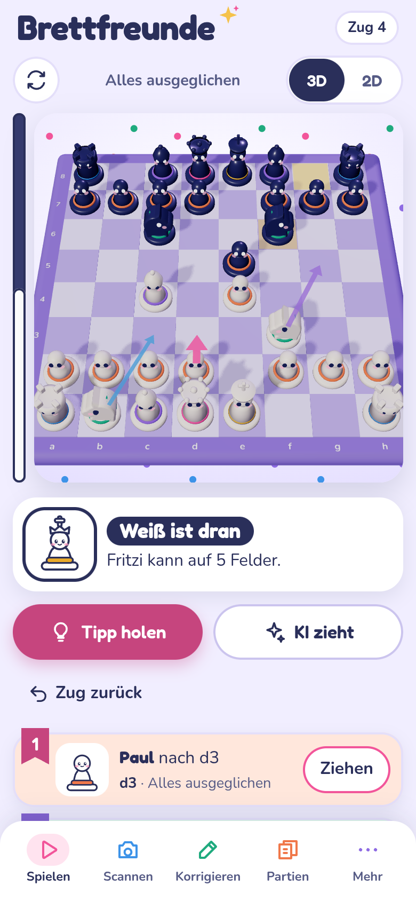
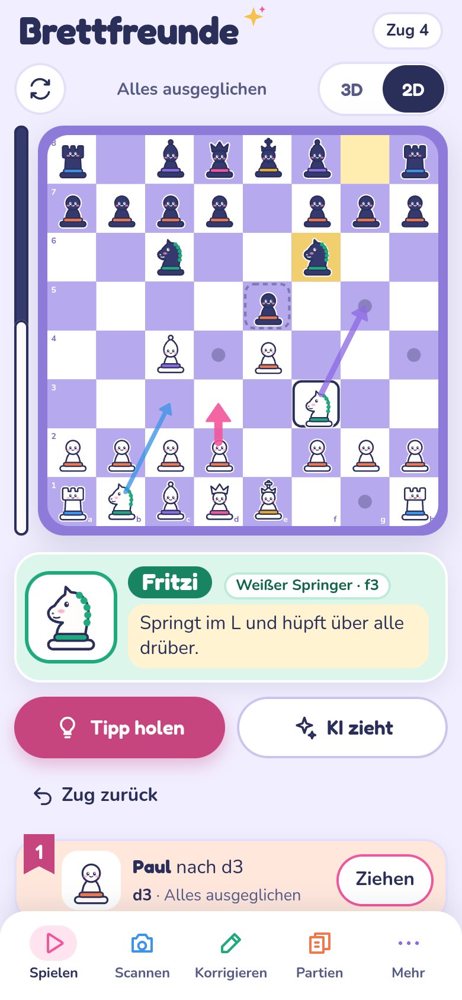
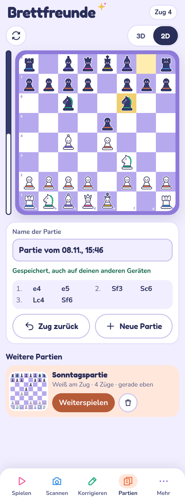
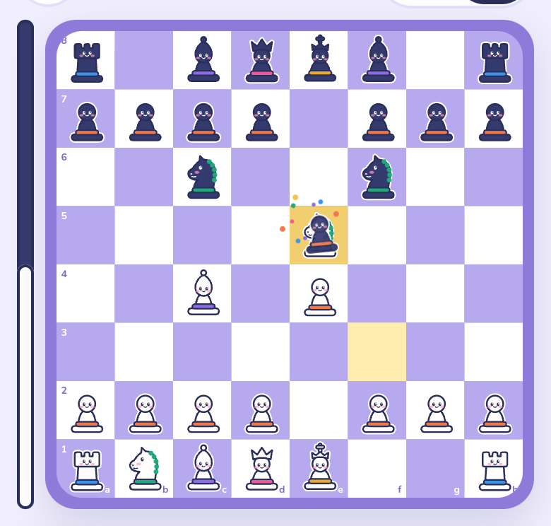
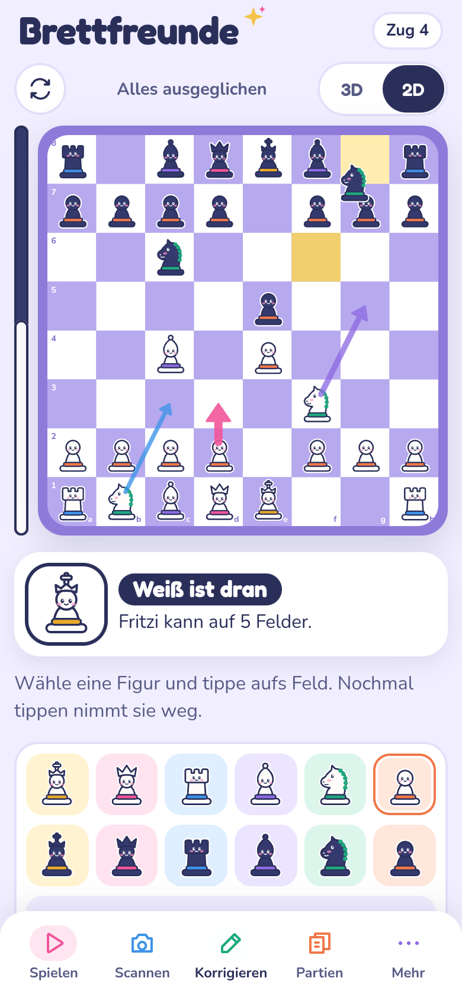
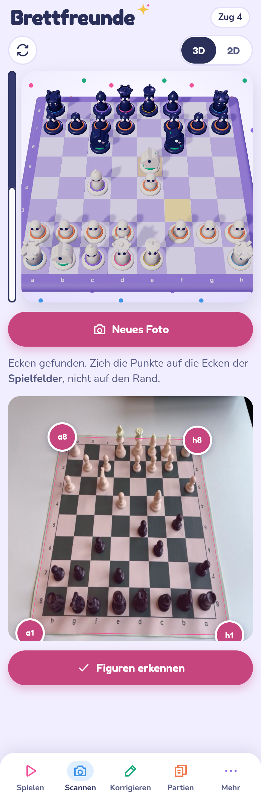
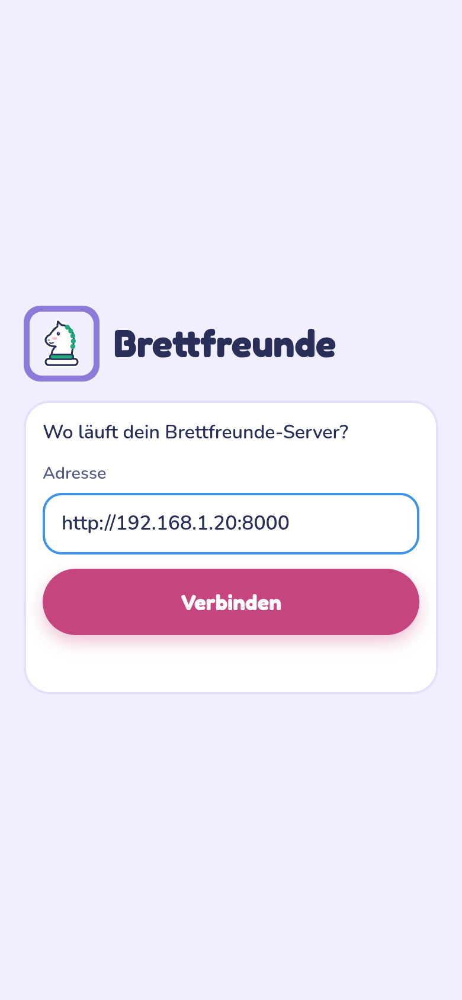
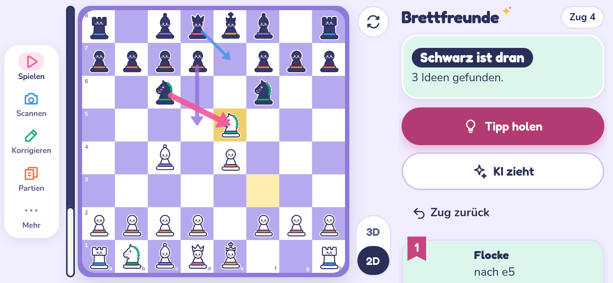
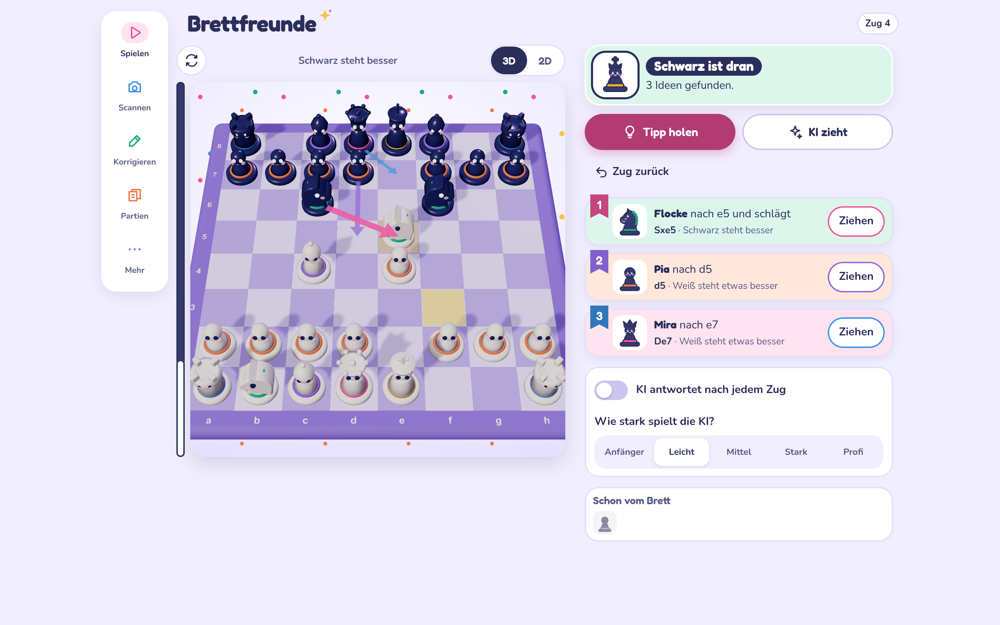

# Brettfreunde (ChessVision Sim)

**Photograph a real chessboard, check the position on your phone, then keep playing with hints or against the engine.** A self-hosted family chess companion: FastAPI + OpenCV + YOLOv8 + Stockfish on a small home server, a Svelte/Three.js web app, and a thin Android app. No accounts, no cloud.

The user interface is in German (it was built for a German-speaking family). API and documentation are in English; code comments are mostly German.

<p>
  
  
  
</p>

## Features

- **Scan a real board.** Take a photo, adjust the four corner pins, and the board is rectified and the pieces are detected (YOLOv8 with foot-point projection). Correct anything the detector missed in the editor.
- **3D and 2D board.** A rotatable 3D board (Three.js) with animated moves, and a 2D board with drawn pieces for quick corrections.
- **Pieces as characters.** Every piece type has a name, a colour and one sentence on how it moves ("Springt im L und hüpft über alle drüber"). Selecting a piece shows its name plate and the squares it can reach.
- **Stockfish hints.** The three best moves as ranked cards with matching arrows on the board, an evaluation bar and the evaluation in words ("White is slightly better").
- **Play against the engine** at five levels from beginner to full strength. The two lowest levels use Stockfish's `Skill Level`, because `UCI_Elo` starts at 1320, which is too strong for children.
- **Saved games across devices.** Every move is saved on the server. Start with a photo on the phone, continue on the PC or tablet. Move list in German notation and undo.
- **Capture animation, landscape layout, PWA manifest, Lichess export, copy FEN.**
- **Android app**: a Capacitor shell that asks for the server address once and then loads the web app from the server, so app and server always match.

| Capture | Editor | Scan | App start |
|---|---|---|---|
|  |  |  |  |





## How it works

```
photo ──▶ corner detection ──▶ homography ──▶ YOLOv8 pieces ──▶ foot points ──▶ 8×8 grid ──▶ FEN
                (OpenCV)        (4 points)                       (projected)                   │
                                                                                               ▼
web app (3D/2D board, editor) ◀──────────── python-chess (legal moves) ◀──────── Stockfish (UCI)
```

1. **Corner detection** (`vision_engine.detect_board_corners`): grayscale, bilateral filter, adaptive threshold plus Canny, morphological closing, then the largest convex quadrilateral (15–98 % of the image), with convex hull and minimum-area rectangle as fallbacks. Corners are ordered `[a8, h8, h1, a1]` via coordinate sums and differences.
2. **Homography**: `cv2.getPerspectiveTransform` maps the four corners onto an 800 × 800 px square (100 px per square). The user can drag the pins before scanning; the automatic detection often picks the mat border instead of the playing area.
3. **Foot-point projection** (`map_pieces_to_grid`): real pieces lean into neighbouring squares when photographed at an angle, so the square is taken from the piece's base, not the box centre: x = (x₁ + x₂)/2, y = y₁ + 0.85 · (y₂ − y₁), projected with the homography. On collisions the more confident detection wins.
4. **FEN**: castling rights are only granted when king and rook stand on their home squares; en passant starts empty.
5. **Game logic**: python-chess validates moves; the web app keeps the full FEN from the server (castling rights, en passant, move counters) and only rebuilds it after manual edits.

## Repository layout

```
backend.py            FastAPI server: REST API, python-chess, Stockfish
games_store.py        saved games as JSON files (replayed and validated on every save)
vision_engine.py      corner detection, homography, YOLO foot-point mapping
frontend/             web app source (Vite + Svelte 5 + TypeScript + Three.js)
static/               built web app, generated by `npm run build` in frontend/ — do not edit
app/                  Android app (Capacitor shell)
training/             training script for the piece detector (Google Colab) and metrics
tests/                pytest: API tests and Playwright browser flows
docs/screenshots/     screenshots used in this README
PRODUCT.md, DESIGN.md product context and design system
```

## Quick start

Requirements: Python 3.11+, [Stockfish](https://stockfishchess.org), optionally Node.js 20+ (only to rebuild the web app) and the Android SDK (only for the app).

```sh
git clone https://github.com/nilsgollub/ChessVision_Sim.git
cd ChessVision_Sim
python -m venv .venv && . .venv/bin/activate
pip install fastapi uvicorn python-multipart opencv-python-headless numpy chess
sudo apt install stockfish        # Debian/Ubuntu/Raspberry Pi; on Windows set STOCKFISH_PATH
python backend.py                 # serves on 0.0.0.0:8000
```

Open `http://<server-ip>:8000` on your phone or computer. The built web app in `static/` is part of the repository, so no Node.js is needed to run it.

**Stockfish** is searched in this order: environment variable `STOCKFISH_PATH`, `stockfish` on `PATH`, then `/usr/games/stockfish`, `/usr/bin/stockfish`, `/usr/local/bin/stockfish`, `C:/stockfish/stockfish.exe`. If none is found, the error message lists every location it tried.

**Saved games** live in `data/games/` as one JSON file per game (`BRETT_DATA_DIR` changes the location).

### Piece detection (optional)

Without a model the scan still rectifies the board and loads the start position, which you then correct in the editor. With a model, place `chess_yolov8n.pt` in the project root and install Ultralytics; the CPU build of PyTorch is enough for single photos:

```sh
pip install torch torchvision --index-url https://download.pytorch.org/whl/cpu
pip install ultralytics
```

`training/train_colab.py` trains a starter model on two public datasets (CC BY 4.0) in about five minutes on a Colab L4 GPU. It filters out broken samples (images without labels, labels belonging to a rotated image). First run: mAP50 0.98 on validation and 0.97 on test, see `training/metrics.json`.

```sh
pip install ultralytics huggingface_hub pandas pillow
python training/train_colab.py --epochs 100 --data-dir ./dataset --out ./out
cp out/chess_yolov8n.pt .
```

The datasets show other boards than yours. For reliable results on your own set, fine-tune with 30–50 labelled photos of your board.

### Docker

The image contains Stockfish, Ultralytics and the CPU build of PyTorch (about 2.8 GB). The model is not part of the image; mount it if you have one, otherwise leave that line out.

```sh
docker build -t brettfreunde .
docker run -d --name brettfreunde --restart unless-stopped -p 8000:8000 \
  -v "$PWD/data:/data" \
  -v "$PWD/chess_yolov8n.pt:/app/chess_yolov8n.pt:ro" \
  brettfreunde
```

## Web app development

```sh
cd frontend
npm install
npm run dev      # dev server with live reload, proxies /api to port 8000
npm run build    # writes the production build to ../static
```

## Android app

`app/` is a thin [Capacitor](https://capacitorjs.com) shell (`ch.gollub.brettfreunde`). On first start it asks for the server address, checks that the server answers, remembers it and then loads the web app from the server; "Mehr → Server wechseln" switches servers later. Because the UI comes from the server, a new frontend needs no new APK.

```sh
cd app
cp www/presets.example.js www/presets.js   # optional: quick-pick server addresses for your own build
npm ci
./publish.sh                               # builds android/app/build/outputs/apk/release/app-release.apk
```

The version code is the number of commits, so commit before building. The release build is signed with the debug key of the build machine, which is enough for sideloading or a private F-Droid repository. An optional, untracked `app/publish.env` with `PUBLISH_CMD=/path/to/script.sh` hands the APK to your own publishing step.

## API

| Method | Path | Purpose |
|---|---|---|
| POST | `/api/detect-corners` | photo → four normalised corner points |
| POST | `/api/scan-board` | photo + corners → FEN and rectified preview |
| POST | `/api/make-move` | FEN + move → new FEN, SAN, check/mate |
| POST | `/api/legal-moves` | FEN → all legal moves (UCI) |
| POST | `/api/engine-analyze` | FEN → top moves (MultiPV) with evaluation |
| POST | `/api/engine-play` | FEN + level 1–5 → engine move |
| GET | `/api/engine-levels` | available engine levels |
| GET, POST | `/api/games` | list saved games, create a game |
| GET, PUT, DELETE | `/api/games/{id}` | load, save, delete a game |

## Tests

```sh
pip install -r requirements-dev.txt
pytest
```

API tests run without the YOLO model. The Stockfish tests are skipped when Stockfish is missing, the browser tests when Playwright or Chromium is missing (`CHROMIUM_PATH=/path/to/chrome pytest` uses an existing Chromium). The 3D tests need WebGL; headless Chromium provides it via SwiftShader.

## Security

The server has **no authentication**. Run it only in your home network or behind a VPN such as Tailscale or WireGuard, never directly on the internet. Saved games are validated by replaying every move; game IDs are restricted to `[a-z0-9]`, so requests cannot reach files outside the data directory. The only feature that sends data outside your network is the "Open in Lichess" button.

## Known limitations

- The automatic corner detection often finds the border of a roll-up mat instead of the 8 × 8 playing area; drag the pins onto the corners of the squares before scanning.
- The starter model was trained on other boards and is not yet fine-tuned for any particular set.
- Over plain HTTP, Chrome cannot install the web app as a full-screen PWA; use the Android app or put the server behind HTTPS.
- The UI is German only.

## License

[GNU Affero General Public License v3.0](LICENSE). Fonts, libraries and training data are credited in [THIRD_PARTY_NOTICES.md](THIRD_PARTY_NOTICES.md). The optional piece detector uses [Ultralytics YOLO](https://github.com/ultralytics/ultralytics) (AGPL-3.0); the chess logic uses [python-chess](https://github.com/niklasf/python-chess) (GPL-3.0); the engine is [Stockfish](https://stockfishchess.org) (GPL-3.0).
